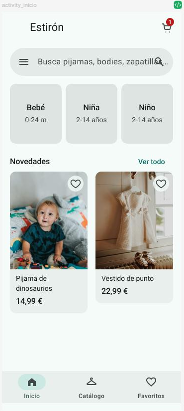
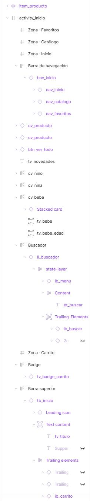

# A1 · Análisis del diseño: pantalla Inicio

Pantalla elegida: **Inicio** de Estirón (frame `activity_inicio`, 360 × 800 dp). Tiene iconos, fotos de producto, siete estilos de texto y botones (de icono y de texto).

<p align="center">
  
</p>

## Árbol de bloques

Leyenda: **[NP]** no se programa · **[SUP]** se superpone a otro bloque · **[REP]** se repite.

```
activity_inicio · ConstraintLayout (360 × 800 dp, fondo surface)
├── tb_inicio · MaterialToolbar (64 dp)
│   ├── tv_titulo · TextView «Estirón»
│   ├── fl_carrito · FrameLayout (agrupa botón y número)
│   │   ├── ib_carrito · ImageButton (ic_carrito)
│   │   └── tv_badge_carrito · TextView «1» (bg_badge_carrito) ... [SUP] sobre ib_carrito
│   └── Icono inicial (opacidad 0), acciones 2 y 3 y texto secundario ocultos ... [NP]
├── ll_buscador · LinearLayout horizontal (bg_buscador)
│   ├── ib_menu · ImageButton (ic_menu)
│   ├── et_buscar · EditText (hint «Busca pijamas, bodies, zapatillas…»)
│   └── ib_buscar · ImageButton (ic_buscar)
├── ll_categorias · LinearLayout horizontal ......................... [REP] ×3
│   ├── cv_bebe · MaterialCardView
│   │   ├── tv_bebe · TextView «Bebé» ................ [SUP] en Figma, sobre el fondo de la tarjeta
│   │   └── tv_bebe_edad · TextView «0-24 m»
│   ├── cv_nina · MaterialCardView → tv_nina, tv_nina_edad
│   └── cv_nino · MaterialCardView → tv_nino, tv_nino_edad
├── tv_novedades · TextView «Novedades»
├── btn_ver_todo · MaterialButton de texto «Ver todo»
├── rv_novedades · RecyclerView horizontal .......................... [REP] item_producto
│   └── cv_producto · MaterialCardView (layout item_producto.xml)
│       ├── iv_producto · ImageView (img_pijama_dinosaurios / img_vestido_punto)
│       ├── ib_favorito · ImageButton (bg_favorito + ic_favorito) .... [SUP] sobre iv_producto
│       ├── tv_nombre_producto · TextView
│       └── tv_precio_producto · TextView
├── bnv_inicio · BottomNavigationView (menú con 3 ítems) ............ [REP] ×3
│   └── nav_inicio · nav_catalogo · nav_favoritos (ítems del menú, no son vistas)
└── Zona · Carrito / Inicio / Catálogo / Favoritos (zonas del prototipo) ... [NP] [SUP]
```

## Comparación con el panel de capas

<p align="center">
  
</p>

| En el panel de capas de Figma | En el árbol de Android | Motivo |
|---|---|---|
| Marcos envoltorio «Barra superior», «Buscador», «Badge» y «Barra de navegación». | No existen. | Solo sirven para colocar el componente en Figma; en Android cada vista se coloca con restricciones. |
| «Badge» es un marco suelto encima de la barra superior. | `fl_carrito` agrupa `ib_carrito` y `tv_badge_carrito`. | Para poner el número encima del icono dentro de la toolbar hace falta un contenedor. |
| Las tres categorías son marcos sueltos. | `ll_categorias` con tres `MaterialCardView`. | Son iguales y se reparten el ancho con `layout_weight`. |
| En cada categoría, los textos están encima de la tarjeta «Stacked card». | Los textos van dentro de la tarjeta. | En Android la tarjeta es un contenedor; la superposición desaparece. |
| Las dos tarjetas de producto son instancias del componente `item_producto`. | `rv_novedades` + `item_producto.xml`. | Lo que se repite se programa una vez y se rellena con datos. |
| Capas internas del kit de Material 3 (State-layer, Content, iconos con opacidad 0, Slot-component oculto). | No existen. | Las dibuja el propio componente de Material (estados y ripple). |
| El texto de ayuda del buscador se monta debajo del icono de búsqueda. | `et_buscar` solo ocupa el hueco entre los dos iconos. | Con `layout_weight="1"` el texto no puede invadir el icono. |
| «Textos» (auto layout) dentro de la tarjeta de producto. | No hace falta. | Con ConstraintLayout cada texto se coloca respecto al anterior. |
| «Fondo favorito» (elipse). | `bg_favorito.xml`, fondo de `ib_favorito`. | No es una vista: es un drawable XML. |
| Zonas transparentes del prototipo. | No existen. | En Android la navegación va en el `OnClickListener` de cada vista. |
| El panel muestra arriba la capa que está delante. | En el XML la primera vista es la que queda detrás. | El orden se invierte al pasar de Figma a XML. |
